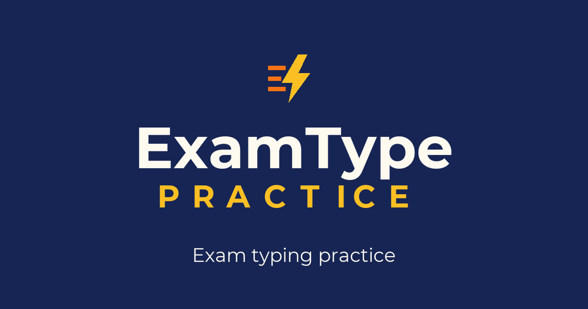

[](https://github.com/pranavlal18/examtype-practice)

# ExamType Practice

**Exam typing practice** — free, open-source typing practice for Indian government competitive exams and general typing.

**ExamType Practice** is a fork of [Monkeytype](https://github.com/monkeytypegame/monkeytype) (GPL-3.0) focused on **SSC CGL DEST**, **SSC CHSL** and **RRB NTPC** typing preparation, plus general practice for everyone who wants a calm place to improve.

> This is an independent practice tool. It is **not affiliated with, endorsed by, or approved by** the Staff Selection Commission, Railway Recruitment Boards, Indian Railways, Government of India or Monkeytype. Exam names are used only to describe what the practice material is for. Cutoffs and exam patterns vary by post and year; always confirm the current official notification for your exam.

## What it adds

- **Real Exam Mode (`/exam`)** — split-screen SSC-style practice: passage on top, plain textarea below, 15/10/5-minute countdowns, no live highlighting/auto-scroll, mistakes revealed after submission. Optional backspace-disable drill.
- **Exam-style scoring** — key depressions, KDPH reference, net WPM, word-level full/half mistakes, and category-wise reference PASS/FAIL badges. Cutoff references are informational, not official.
- **Custom Text** — paste a passage and practice in exam conditions.
- **Local-first and private** — your practice history is stored in your browser. No accounts, ads, analytics or backend are required.

## Build and deploy

```bash
pnpm install
pnpm build-fe
```

The static output is `frontend/dist/`. Serve it with an SPA fallback from `/` to `/index.html`. A `vercel.json` is included for Vercel; see [`docs/DEPLOYMENT_EXAMETYPE.md`](docs/DEPLOYMENT_EXAMETYPE.md) for the free deploy path.

No backend or environment variables are required. Do not set `BACKEND_URL` or `RECAPTCHA_SITE_KEY` for this deployment.

## Data, privacy and legal

- Typing history and settings are stored in your browser’s local storage.
- The fork does not run accounts, ads, analytics, crash reporting or a hosted database.
- GPL-3.0 license is retained. Modifications are open source under the same license.
- Source is intended to be available at <https://github.com/pranavlal18/examtype-practice>. That repository must exist and be public before the deployed footer link works.
- Fonts and bundled assets are listed in [`THIRD_PARTY_NOTICES.md`](THIRD_PARTY_NOTICES.md).

## Contributing

Issues and bug reports: use the public GitHub issue tracker for the project once it is pushed.

This fork is maintained separately from upstream Monkeytype. Changes here are not submitted to upstream unless explicitly coordinated.

## Code of conduct

See [docs/CODE_OF_CONDUCT.md](docs/CODE_OF_CONDUCT.md).

## Credits

- [Monkeytype](https://github.com/monkeytypegame/monkeytype) by Miodec and contributors — the upstream codebase this fork builds on.
- [Montydrei](https://www.reddit.com/user/montydrei) for the original upstream prototype naming feedback.
- Everyone who reported issues and helped shape the typing practice experience.

## License

GPL-3.0. See [LICENSE](LICENSE). Monkeytype is copyright its authors. ExamType Practice modifications remain GPL-3.0.
